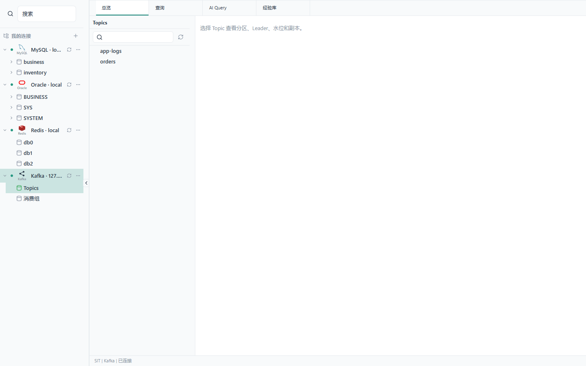
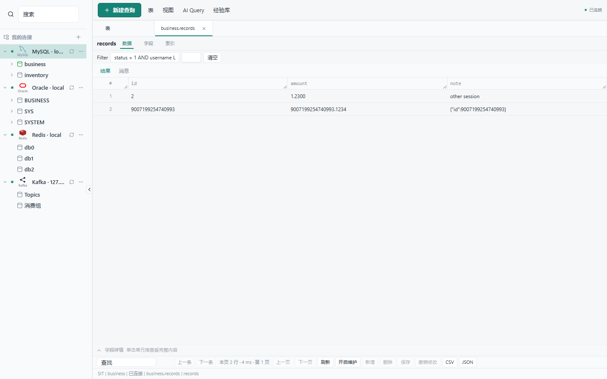
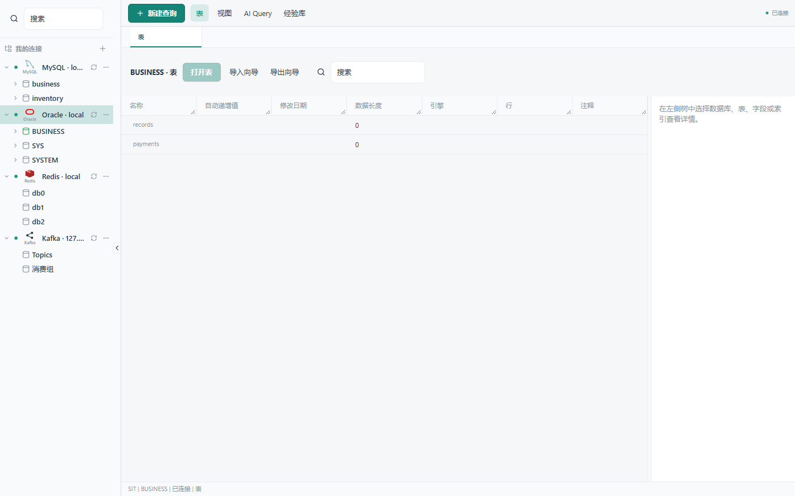
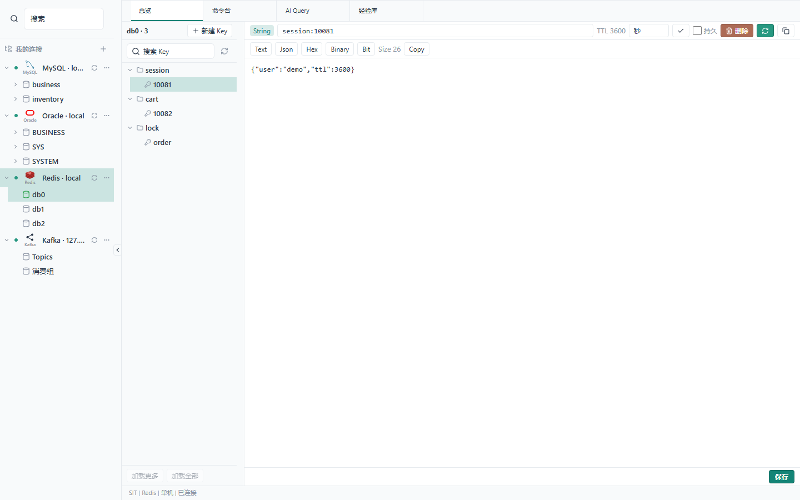
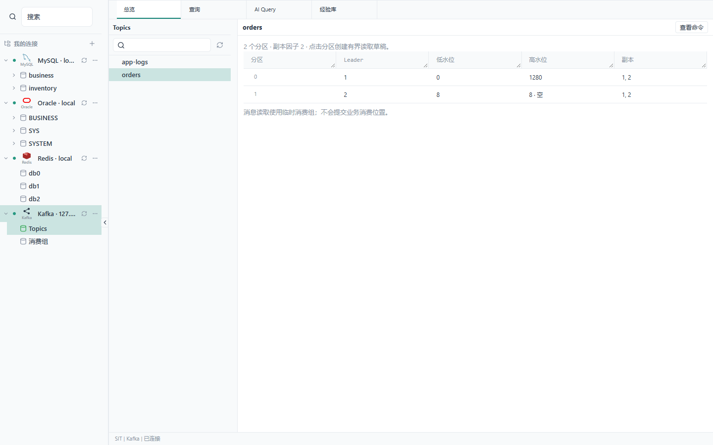

# DSH Database

[](LICENSE)
[](cordis.patch.yml)

[](https://github.com/zhuoxiaoshuai/dsh-database)

在 DeepSeek Harness 会话右侧连接 MySQL、Oracle、Redis、Kafka 和 Nacos，浏览对象、运行查询，并与 AI 共用查询编辑器。支持 SQL 网格维护与经验库，以及 Kafka 消息检索和 SIT 排障操作。

这份仓库全程由 AI 编写。

[English](README.md) · [安装](#安装) · [首次使用](#首次使用) · [权限](#ai-协作与权限) · [开发](#开发) · [文档](docs/README.md)



截图里的库名、表名是测试数据。

## 功能概览

| 数据源 | 常用功能 |
| --- | --- |
| MySQL／Oracle | 库／Schema、表、列和结构；多查询与对象页签、SQL 批量、执行计划、网格维护、SQL 经验分析 |
| Redis | DB／Key 浏览、类型、TTL、值和单条命令台 |
| Kafka | Topic／消费组、分区、水位与 Lag、消息预览、有界检索，以及 SIT 发布与修复 |
| Nacos 2.4.3 | Namespace、Group/Data ID 搜索、配置发布/删除、历史/Diff、监听者与服务实例读取 |

SQL、Redis、Kafka 共享查询、AI Query、历史和经验入口。Nacos 通过资源页面复用连接外壳、页签、编辑器、列表和操作记录，不创建 SQL/命令文档或经验库。

Nacos 2.4.3 支持配置编辑、历史/Diff、监听者、服务和实例查询。人工在所有环境预览确认后可写；AI 仅 SIT 可写，局部修改保留敏感值。发布支持 YAML/JSON/Properties/XML/HTML 校验，在主题一致的对比框中显示错误并阻止提交；Text 明确不校验。XML/HTML 支持 SIT AI 安全局部修改。详见 [Nacos 指南](docs/datasource/nacos.md)。

## 安装

```sh
dsh plugin --profile web add https://github.com/zhuoxiaoshuai/dsh-database/releases/download/v0.1.0-alpha.12.15/dsh-database.tgz
```

装完后重启 `dsh web`。需要 Node.js 24 或以上。git 仓库里没有 `lib/`，不要用 `github:` 安装。

如果已经克隆了仓库，也可以在本地打包：

```sh
npm ci --legacy-peer-deps
npm pack
dsh plugin --profile web add ./dsh-database-0.1.0-alpha.12.32.tgz
```

卸载：

```sh
dsh plugin --profile web remove dsh-database
```

不要把 `cordis.patch.yml` 再抄进 profile。

桌面版的 PATH 里没有 `dsh`。从托盘打开 **DSH 终端**，然后执行：

```sh
dsh plugin --profile desktop add https://github.com/zhuoxiaoshuai/dsh-database/releases/download/v0.1.0-alpha.12.15/dsh-database.tgz
```

插件是同一份，只是 profile 不同。`--profile web` 不会装进桌面应用。

上述下载链接指向 `alpha.12.15` 发布包。本地源码当前为 `alpha.12.47`；包名以 `npm pack` 的输出为准，打包时会自动构建。发布包与本地源码的验收记录应分别核对。

## 首次使用

1. 安装并重启对应 profile 后，打开会话右侧的「数据库」页签。
2. 点击「我的连接」旁的 **＋**，选择数据源，填写地址、账号及目标库／Service Name／DB 或 Broker 列表，选择 SIT、UAT 或 PVT。
3. 可先点击「测试连接」检查配置，再点击「连接」。提交后窗口关闭，连接在后台建立；连接行显示进度，可取消或在失败后编辑配置。测试成功本身不会把连接加入列表。
4. SQL 选择目标库／Schema 后，在查询页执行 MySQL 的 `SELECT 1;` 或 Oracle 的 `SELECT 1 FROM DUAL;`；Redis 执行 `PING`；Kafka 执行 `TOPICS`。
5. 需要 AI 协作时，打开 **AI Query**，在对话中说明连接、目标和任务，例如“查看当前 SQL，解释它的作用”。执行前核对当前目标与权限。

SQL 查询和 AI Query 的「格式化全文」在有选区时变为「格式化选中」，只替换选区，支持一次撤销／重做。选中 `A001 A002`、多行编号或 `(001 002)` 后格式化，会自动变为 `'A001', 'A002'` 或 `('001', '002')`，方便构造 IN 条件。空格、换行、Tab 和英文逗号可混用；原有括号、顺序、重复项及前导零会保留。

自动转换仅适用于至少两个由字母、数字、中文或下划线组成的非关键字裸值，且至少一对值之间缺少逗号。已有完整逗号列表（如 `1, 2`）、引号、表达式及复杂符号按 SQL 排版；无选区时只排版全文。独立选区 `a b` 按两个值转换；UUID、日期、邮箱等不自动转换。空白选区不处理，截断词元、字符串或注释的选区会提示重新选择。AI Query 中纯排版保持控制权，自动构造字符串列表及撤销／重做按人工编辑接管；格式化不会执行 SQL。

## 连接生命周期与隔离

连接的建立、目录加载、失败和恢复按连接独立管理。A 正在连接时仍可连接、查询或断开 B；后台完成不会切换当前工作区。每个连接同时只接受一个生命周期操作，重复操作 ID 不会重复派发；编辑使用候选 Worker，失败或取消保留原配置与在线登录。关闭表单、切换对话或 HTTP 回执丢失不会撤销已接受的后台连接，显式取消、断开、删除或卸载会终止它。

成功登录后的网络故障按 0.5、1、2、5、15、30、60 秒退避，随后每 60 秒恢复一次，加入 ±20% 抖动。认证、证书或配置错误停止自动恢复；首次登录失败保留离线条目，需修正配置后再连接。主动断开和停止恢复会持久保存离线意图，AI 状态查询只返回当前状态并触发符合该意图的后台恢复。Worker 丢失且无可复用凭据时需重新登录；密码和自定义 CA 仍只按既有加密保存选项保存。

最多 20 个活动或待连接的逻辑连接；建连及测试总并发 6，后台恢复最多占 4 个。查询每连接最多 3 个、AI 最多 2 个，全局最多 16 个、AI 最多 14 个。目录预加载总并发 4、每连接最多 1 个，前台优先并按连接轮转。取消或超时后底层请求须结束，否则回收对应 Worker；旧连接代次的目录任务与结果会失效。恢复不重放结果未知的写入。导入或复制的配置默认离线；旧文件缺少离线意图时按原有可复用登录规则兼容。

受控生命周期回归和真实工作台组件验收使用模拟数据库 Worker。真实数据库断网与恢复、安装版 Desktop 验收仍需单独执行，未执行项为 `NOT_RUN`。

## AI 协作与权限

在 AI Query 中输入，或点击「接管」，会切换为用户控制；此时 AI 不能覆盖文本。编辑完成后点击「归还 AI」，让模型继续协作。普通查询页与 AI Query 是不同入口。

| 操作 | SIT | UAT／PVT |
| --- | --- | --- |
| 人工普通 SQL／接管后的共编 SQL | 读取及 DML，按账号权限自动提交 | 读取及 DML，按账号权限自动提交 |
| AI SQL | 读取及 DML | 只读 |
| 网格改数／结构化 DDL | 人工预览与确认后执行 | 禁用 |
| 人工 Redis 命令台 | 按 ACL 和命令校验执行 | 按 ACL 和命令校验执行 |
| AI Redis | 结构化读取及 `redis_execute` | 结构化读取；禁用 `redis_execute` |
| Kafka 读取 | 支持 | 支持 |
| Kafka 写操作 | 人工确认或 AI 工具执行，仍受 Broker 权限限制 | 禁用 |

**UAT／PVT 不会阻止人工 SQL 或人工 Redis 命令写入。** 需要禁止写入时，请使用只读数据库账号或 Redis ACL。SIT 的 AI SQL 查询结果按原值返回给模型；普通人工查询不会因此自动发送结果给模型。

导入连接时，`dev`／`test` 归为 SIT，`staging` 归为 UAT，`prod` 归为 PVT，其他未知写法按 UAT 处理。密码默认只在当前登录期间保留于内存；Windows 可选「记住密码」，使用当前用户 DPAPI 加密保存。详见 [SECURITY.md](SECURITY.md)。

写操作中断或丢失回执时，结果可能标为「未知」：数据可能已经写入。先核对实际状态，再决定下一步；系统不会自动重放未知写入。重连会使旧请求与执行目标失效。

## MySQL



驱动是 mysql2，默认端口 3306。对象树按库 → 表 → 列展开。标识符用反引号，分页用 `LIMIT` / `OFFSET`。`mysql`、`information_schema`、`performance_schema`、`sys` 会留在树上。

```sql
SELECT 9007199254740993 AS id;
```

账号有权限时，目录里能看到字段、索引、约束和 `SHOW CREATE`。没有权限时会写出原因，而不是空白失败。

查询的筛选、排序和分页在库端完成。默认返回 100 行，上限是 500 行或 1 MiB。取消查询不会断开这次登录。

网格改数走参数化语句：先预览，确认一次，并按主键核对原记录。发生冲突会回滚，草稿还留着。

DDL 最多 20 步，审批有效期 5 分钟。破坏性操作要在窗口里填写表名。某一步失败就停，不会把整段 DDL 当成一次事务回滚。

`database_execute_sql` 最多执行 8 条语句，每条最多 100 行；UAT／PVT 只读，SIT 可执行 DML。整批先做静态校验，再顺序执行，第一条出错后停止。已提交语句不会因后续失败自动回滚。

BIGINT 在驱动里就会以字符串返回。二进制单元格显示可读 UTF-8 文本或十六进制字节（BIT 显示二进制位），二进制列在网格中保持只读。

## Oracle



SQL 页面和 MySQL 相同。对象按 Schema 组织；未加双引号的 SQL 标识符按 Oracle 规则转为大写，加双引号时保留大小写。如果存在与用户名同名的 Schema，默认进入那个 Schema。标识符用双引号；分页用 `OFFSET … ROWS FETCH FIRST … ROWS ONLY`；执行计划用 `EXPLAIN PLAN FOR`。q-quote 可以使用，`#` 注释不行。

驱动是 oracledb Thin，默认端口 1521，连接表单支持 Service Name 和 SID；SID 实连验收仍为 `NOT_RUN`。NUMBER 和时间类型按 STRING 取出。视图和同义词只能看元数据。查询如果带 LOB 列会失败。

## Redis



需要 Redis 7.2 或以上。对象树按 DB → Key 展开。SCAN 分页可能出现空页或重复，游标还没结束时界面会标明。

```text
PING
```

支持单机、一台哨兵，或一个集群种子节点。ACL、TLS、自定义 CA 都是可选的。哨兵只填一个地址，用户名和密码在哨兵与 Redis 之间共用。集群模式下，主机字段是种子节点，DB 只能是 0。

Key 浏览和命令台用的不是同一条连接。命令台执行一条 CLI 写法的命令后就会关闭。在命令台里执行 `SELECT` 或 `MULTI`，不会改左边的树。

人工命令台在 SIT／UAT／PVT 均可执行命令；AI 的 `redis_execute` 仅在 SIT 可用，其他环境使用结构化读取工具。`DSH_REDIS_COMMAND_BLACKLIST` 默认是空的，实际限制仍看 Redis ACL。

## Kafka



支持 Topic／消费组搜索与分页、分区和 Lag 查看、Topic 配置、按时间定位和有界消息检索。PEEK 使用临时消费组且不提交业务消费位点。

```text
TOPICS SEARCH "orders"
GROUP "billing" TOPIC "orders"
PEEK "orders" PARTITION 0 FROM LATEST LIMIT 20
```

把示例中的 Topic 和消费组替换为实际名称。SIT 可发布单条／限量批量消息、重发完整消息、发布 compact 墓碑、创建 `dsh-test-` Topic，以及调整无运行成员消费组的位点；已有消息不能原地修改。

支持无认证、TLS＋CA、PLAIN、SCRAM-SHA-256／512；不支持 Kerberos、OAuth 或客户端证书。完整命令、字节与结果上限、确认及未知回执处理见 [Kafka 使用指南](docs/datasource/kafka.md)。

## AI 工具

`database_status` 不传 topic 时返回已登录的 SQL 连接，以及带 `connectionId`、`generation` 的下一步参数。Redis、Kafka、Nacos 用各自的 `*_status`。传 topic 才加载某一节用法。缺连接或 generation 过期时，工具返回当前连接列表。该数据源只有一条已登录连接时，可以省略 `connectionId` 和 `generation`。`database_execute_sql` 传入 `sql` 就会执行，即使同时带了 `action=read`。`action=read` 且没有 `sql` 时读取最近活动的 SQL 连接的当前语句；工作台没有语句时返回 `empty`，不回空 `sql`。列表和结构用 `database_catalog`，不要 `SHOW TABLES`。

`kafka_scan` 与 `kafka_set_group_offsets` 的 `spec`、`kafka_produce` 的 `headers` 是对象，`kafka_produce_batch` 的 `messages` 是数组。`kafka_peek` 的 `from` 取 `BEGINNING`、`LATEST` 或 `OFFSET`。

<details>
<summary>展开工具参考</summary>

| 工具 | 说明 |
| --- | --- |
| `database_status` | 已登录 SQL 连接，以及可直接套用的下一步参数。传 topic 只返回那一节用法 |
| `database_catalog` | `schemas` / `tables` / `table`。不要用 SQL 去查 `information_schema` |
| `database_execute_sql` | `action=read` 读取当前 AI Query 文本；带上 `sql` 则执行；UAT／PVT 只读，SIT 可写 |
| `database_templates` | 保存和搜索文本，不会执行 |
| `database_read_collab` | 当前打开的查询页签 |
| `database_import_connections` | 登记主机，不接收密码 |
| `redis_status` `redis_keys` `redis_value` | 已登录 Redis 连接；SCAN、类型、TTL、值 |
| `redis_execute` | 仅 SIT，一次一条命令 |
| `kafka_status` `kafka_topics` `kafka_describe` | Topic、分区、水位 |
| `kafka_peek` | peek 一个分区。`from` 为 `BEGINNING`、`LATEST` 或 `OFFSET`。接管编辑器后会拒绝 |
| `kafka_groups` `kafka_group` | 搜索／分页消费组，查看状态和成员 |
| `kafka_group_topics` `kafka_group_topic` | 分页关联 Topic，查看提交位置和 Lag |
| `kafka_topic_config` `kafka_time_offsets` `kafka_scan` | Topic 配置、按时间定位和有界跨分区检索。`kafka_scan` 的 `spec` 是对象 |
| `kafka_produce` `kafka_produce_batch` `kafka_tombstone` | SIT 单条／批量发布及 compact 墓碑。`headers` 是对象，`messages` 是数组 |
| `kafka_create_topic` `kafka_set_group_offsets` | SIT 创建测试 Topic、调整无运行成员消费组位点 |

</details>

## 常见问题

| 现象 | 处理方法 |
| --- | --- |
| 插件安装后没有页签 | 重启安装时选择的 profile，刷新页面；不要重复手写 `cordis.patch.yml` |
| 桌面版找不到 `dsh` | 从托盘打开 DSH 终端 |
| `/plugins/database/connections` 冲突 | 检查旧版 remote-exec 是否仍带数据库页面 |
| AI 无法更新或执行当前内容 | 检查是否已接管，保存完成后归还 AI；重连后刷新连接状态 |
| Oracle 查询包含 LOB | 选择普通字段；按需 LOB 查看尚未接入 |
| Redis 命令台 `SELECT` 后左侧 DB 没变 | 在对象树里选择 DB；命令台每次使用独立连接 |
| 写入显示「未知」 | 回读目标确认实际变化，避免直接重复提交 |
| 查询超时 | SQL 驱动查询时限为 25 秒，Host 查询期限为 32 秒；维护与各数据源另有时限，见[超时配置](src/host/request-timeouts.mjs) |

## 开发

需要 Node.js 24 或以上。在仓库目录安装依赖并检查：

```sh
npm ci --legacy-peer-deps
npm run check
npm run test:package-closure
```

`check` 包含 Host／Client 类型检查、单元测试及构建；包闭包检查另行验证运行时文件。数据库实连与浏览器验收单独运行：

| 命令 | 前提与范围 |
| --- | --- |
| `npm run test:sql-workspace` | Microsoft Edge；MySQL／Oracle 客户端受控桥接验收 |
| `npm run test:workspace-races` | Microsoft Edge；共编保存、控制与目标切换竞态 |
| `npm run test:execution-boundary` | Microsoft Edge；执行边界与网格值语义的受控验收 |
| `npm run test:mysql`／`test:oracle` | Docker Linux Engine；创建独占临时数据库并清理，不代表 Oracle 19c／SID 验收 |
| `npm run test:redis` | Docker、OpenSSL；临时 Redis 普通与 TLS 验收，OpenSSL 可通过 `DSH_OPENSSL` 指定 |
| `npm run test:kafka` | Docker、OpenSSL；隔离 Broker 验收 |
| `npm run test:host` | Harness 安装目录（`DSH_DESKTOP_APP`）和 Chrome（可用 `DSH_TEST_BROWSER` 指定其他支持的浏览器）；在临时 profile 中安装并启动 Web 宿主 |

Windows PowerShell 的宿主验收示例：

```powershell
$env:DSH_DESKTOP_APP = 'C:\path\to\DeepSeek Harness'
npm run test:host
# 按需启用实连检查；数据库测试需要 Docker
$env:DSH_TEST_DATABASES = '1'
$env:DSH_TEST_REDIS = '1'
$env:DSH_TEST_KAFKA = '1'
npm run test:host
```

POSIX Shell 使用 `DSH_DESKTOP_APP="/path/to/install" npm run test:host`。测试结果写入 `artifacts/`；受控桥接、隔离实连和安装宿主验收分别记录。`test:host` 不代表真实 Desktop 界面或模型调用已验收。

## 兼容与验收记录

当前依赖：mysql2 3.24.4、oracledb 7.0.1、redis 6.2.1、kafkajs 2.2.4。历史验证涉及 Harness `0.1.2-rc.1`、`0.1.7-rc.2`、`0.2.0-rc.2`，MySQL 8.4／8.0.32、Oracle Free 23／19c Service、Redis 8.10.2 及 Kafka 测试实例；这些记录不自动覆盖后续源码或所有认证组合。

| 记录 | 验证范围与边界 |
| --- | --- |
| [执行边界修复（2026-10-05）](docs/plans/execution-boundary-implementation.md) | 记录类型检查、768 项单测、受控浏览器、构建与包闭包通过；最终四源实连重跑、Oracle 19c／SID、安装版 Desktop、真实模型为 `NOT_RUN` |
| [Kafka 排障扩展（2026-10-04～05）](docs/plans/kafka-repair-implementation.md) | 记录受控回归与阶段隔离实连；最终代码实连重跑及安装／模型验收为 `NOT_RUN` |
| [历史安装与数据源验收](docs/data-source-foundation-progress.md) | 查看当时安装版本、环境与覆盖范围 |

以上是按日期保存的证据。本次 README 整理没有重跑数据库、Desktop 或模型验收；当前源码的验证状态须结合对应构建和实际报告确认。

## 文档与反馈

- [文档索引](docs/README.md)、[架构说明](docs/data-source-architecture.md)、[数据源接入指南](docs/data-source-onboarding.md)
- [Kafka 使用指南](docs/datasource/kafka.md)、[实施记录索引](docs/plans/README.md)
- [Issues](https://github.com/zhuoxiaoshuai/dsh-database/issues)、[安全说明](SECURITY.md)

## 许可证

[MIT](LICENSE)


打包统一使用公共安装器流程，默认只打包；安装需显式指定 `-Install`。参见[打包与独立运行验收](docs/packaging.md)。
