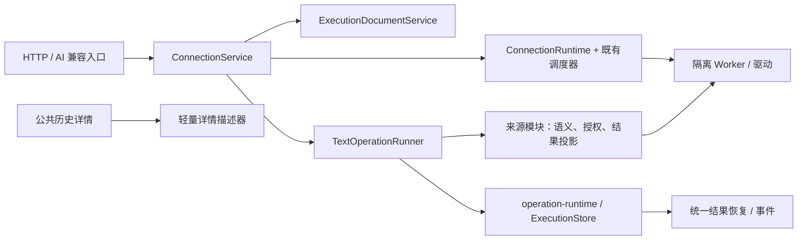

# 架构收敛实施记录

日期：2026-10-13。基于实施开始时的未提交工作树，保留既有修改；未提交、推送或安装。

## 已实施的七项改造

| 审查项 | 实现与行为 | 验证 |
|---|---|---|
| Nacos 防重放 | `NacosPreviewConsumption` 独立维护最多 1024 个已消费凭证，保留到签名令牌过期。签名、基线、连接代次和调用方检查通过后，在任何写入派发前同步消费。容量满时拒绝写入；展示历史裁剪不会释放凭证。索引与进程签名密钥具有相同生命周期。 | 丢失回执、并发提交、105 条历史裁剪、容量耗尽和过期；既有 actor/generation 验证。 |
| 对话活动连接 | `ConversationLayout.lastActiveId` 保存对话选择；`null` 表示已初始化但没有选择。旧全局字段只为尚未迁移的布局提供初始默认值。前端切换对话优先恢复新对话选择。连接配置及物理连接仍共享。 | 双对话隔离、清空、保存失败、重启；真实工作台交叉切换浏览器检查。 |
| 保存失败一致性 | 知识库及连接配置生成候选快照，成功落盘后替换内存。知识库索引只在提交后重建；异步 SQL 解析完成后重新读取最新快照，并校验正文和版本。 | 新增、元数据更新、归档、导入、复制、可见 Schema、断开保存失败；重启一致性；解析期间并发保存。 |
| 统一结果恢复 | `operation-runtime` 接受 `ExecutionResultEnvelope`，执行存储保存来源提供的原生投影。SQL 继续兼容 `result`，同时提供 envelope。公共当前结果恢复与历史详情均支持 envelope。原生恢复缓存最多每条 64 KiB，并受既有记录容量与释放流程限制。 | Redis/Kafka 实际 Host 编排与受控 Worker；事件淘汰后浏览器重新挂载；迟到结果不能覆盖 unknown；敏感正文不写历史磁盘。 |
| 服务和接口边界 | 保留 `ConnectionService` 门面；提取 `ConnectionRuntime` 管理运行状态、时钟和操作索引，`ExecutionDocumentService` 管理文档与控制权，`TextOperationRunner` 管理文本执行编排。继续使用一个 `operation-runtime` 和既有调度器。AI 模块接收自己的窄能力接口；知识提供者区分 SQL/命令存储能力；Explorer 使用来源无关的 `request`。公共执行契约不再导入 SQL 授权证明类型。人工 SQL 页签的执行归属与维护能力检查分别提取到 `useTabExecution`、`useQueryMaintenance`，保留页签独立结果与原目标核验。 | 既有 HTTP action、AI 参数、环境权限、人工批次、调度、取消、generation 和单次生命周期回归。 |
| 历史展示循环依赖 | 提取轻量 `history-registry` 与 Nacos 详情描述器；详情展示不再导入工作区总注册表。Redis/Kafka 复用已有独立描述器。 | 386 个源文件的运行时静态导入扫描：0 个循环；类型检查与 Client 构建。 |
| 会话释放与协议 | 会话释放直接取消内部连接尝试和测试，释放执行等待者、原生/SQL 内存结果、事件、时钟、迁移标记和操作索引，并归档草稿。共享连接配置保留。Worker 公共回执头具有类型及运行校验；非法关联回执终止等待并报告未知效果。Nacos 队列透传取消信号。 | 会话归档与共享配置保留、迟到事件、等待者释放、非法/无关回执、监听器清理；异步历史在已落盘派发状态下的进程中断恢复。 |

门面仍负责兼容入口、连接生命周期协调及能力装配。SQL 授权、事务、批次回执、Redis 命令、Kafka Cursor/Offset 和 Nacos 配置版本保持原有来源语义；没有增加第二套执行状态机，也没有合并人工页签草稿、协作文档和执行快照。

## 验证与证据

- `npm run check`：类型检查通过；全量 **931/931** 测试通过；Host ESM、DSH Client factory、独立预览及 Standalone 构建通过。
- `scripts/execution-boundary-ui-acceptance.mjs`：**10 项**受控浏览器链路通过，包含 Redis/Kafka 事件淘汰后的原生结果恢复；页面错误为 0。
- `scripts/connection-isolation-ui-acceptance.mjs`：**11 项**受控工作台检查通过，包含 A/B 对话各自恢复活动连接。
- `npm run test:package-closure`：2 项运行依赖测试通过；发布清单 79 个文件，所有复制模块的相对运行时导入闭合。
- 新增一致性测试：历史淘汰与并发消费、容量/过期、对话恢复、失败保存及重启、异步并发保存、原生恢复与隐私、进程中断恢复、会话释放。
- 最终测试及构建日志：`artifacts/architecture-check-final.log`；浏览器报告：`artifacts/execution-boundary/browser-report.json` 与 `artifacts/ui/connection-isolation/acceptance.json`。

沙箱内四项回环网络测试受到限制；使用受控本地服务器解除该执行限制后，完整 `check` 全部通过。这些结果不代表真实数据库或正式安装环境验收。

## 性能测量

复跑：`node --experimental-strip-types scripts/architecture-profile.mjs`。输出 `artifacts/architecture-profile.json`；临时目录在关闭存储后清理。

Windows / Node v24.20.0，预热 1900 条操作、达到 2000 条历史容量后：

| 测量 | 样本 | P50 | P95 | 最大 |
|---|---:|---:|---:|---:|
| 创建并完成执行，含全量序列化及生命周期记账 | 150 | 13.88 ms | 16.35 ms | 21.08 ms |
| 约 15 KiB 协作文档同步提交 | 50 | 8.51 ms | 9.85 ms | 10.24 ms |

最终历史 1,299,345 字节；最后异步落盘等待约 11.88 ms。执行计时包含多次序列化及其他记账，并非纯 JSON 编码时间。样本使用受控本地文件系统；没有据此更改持久化顺序或引入第二套缓存。进一步性能优化应针对真实并发量和存储延迟单独验证。

## 保留的能力边界

- 原生结果正文只用于当前 Host 进程的有界恢复，重启后不恢复正文；磁盘历史继续避免保存命令正文和敏感结果。
- 异步历史在尚未刷盘的窗口内不提供崩溃持久性保证。已落盘的 dispatched/running 状态，重启后恢复为 unknown，不能自动重放。
- Nacos 新增/删除的远端并发窗口仍取决于服务端能力；本地单次凭证不能代替远端原子 CAS。
- 本轮完成服务、接口、人工 SQL 执行与维护控制的渐进拆分；布局和业务专属编辑仍留在来源页面中，后续细分应以具体变更需求和测量结果为依据。
- 真实 MySQL/Oracle/Redis/Kafka/Nacos、安装版 DSH Desktop、实际安装和线上运行：**NOT_RUN**。
